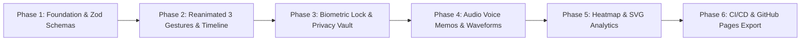

# PROJECT 3: PocketLog — Offline Personal Wellness Journal & Biometric Vault (`plan.md`)

## 1. Project Overview & Goals
**PocketLog** is a privacy-first, local-first daily wellness journal and habit intelligence application built with **React Native (Expo SDK 53)** and **TypeScript**. Designed specifically to showcase high-level mobile engineering capabilities for a **React Native Developer Role**, it complements **CareSlot** (marketplace scheduling) and **ParcelPulse** (mission-critical logistics) by serving as the portfolio's benchmark for **60fps UI thread animations (`react-native-reanimated`), native gesture recognition (`react-native-gesture-handler`), native biometrics (FaceID/TouchID), hardware multimedia (voice memos), interactive data visualization (GitHub-style habit matrix), and tactical haptic feedback.**

It compiles natively for iOS and Android while deploying as a zero-dependency static web application on **GitHub Pages** via `react-native-web`.

### Core Objectives
- **60fps Native Gestures & Fluid Animations:** Implement Reanimated 3 worklets and Gesture Handler micro-interactions—including swipe-to-action timeline cards (swipe-right to mark habits completed, swipe-left to archive/delete), spring-animated habit check toggles, and an interactive draggable bottom-sheet modal running strictly on the native UI thread.
- **Biometric Privacy Vault (`expo-local-authentication` + `expo-secure-store`):** Hardware-backed FaceID, TouchID, and Android Biometric Prompt lock. Integrates an automatic privacy blur screen that obfuscates sensitive journal reflections whenever the app transitions to the background.
- **Interactive Data Visualization & Habit Heatmap:** A GitHub-style 30-day Habit Completion Matrix, weekly/monthly Mood & Energy SVG trend graphs with tap-to-inspect tooltips, and a dynamic streak calculation engine.
- **Audio Voice Reflection Capture (`expo-av`):** Quick voice memo recording for daily audio reflections with an animated waveform visualizer, audio scrubber, and elapsed time counter.
- **Tactile Haptic Feedback Engine (`expo-haptics`):** Platform-native haptic feedback mapping to user touch actions (selection notches, habit completion pulses, warning vibrations on destructive data actions).
- **Local-First Architecture & Service Layer:** Pure async service contract (`IPocketLogApi`) backed by a versioned `AsyncStorage` repository with schema migration capability, seeded with 14 days of realistic demo habit logs on first launch.
- **Data Sovereignty Controls:** Zero third-party trackers, zero external network requests, one-tap JSON export/import backup engine, and a nuclear data-wipe confirmation dialog.
- **OLED Dark / Minimalist Light Theme:** Instant dynamic theme switching (`#0B0F19` deep OLED dark vs. crisp `#F8FAFC` light mode) respecting device system preference without layout flash.

### Non-Goals (Guardrails)
- **No Medical Claims or Clinical Diagnoses:** Focuses strictly on everyday lifestyle reflections (mood rating 1–5, sleep hours, hydration, gratitude, and habit checkboxes).
- **No Paid Cloud SDKs or External Servers:** Operates 100% self-contained in client storage (`AsyncStorage` on native, `localStorage` on Web) for permanent zero-cost hosting.
- **No PII In Demo Data:** Pre-seeded logs use realistic, synthetic personal reflections and creative wellness goals.

---

## 2. Tech Stack & Tooling

| Category | Technology | Rationale & Portfolio Resume Impact |
| :--- | :--- | :--- |
| **Framework** | Expo SDK 53 (React Native 0.79, React 19) | Universal codebase targeting iOS, Android, and static Web export for GitHub Pages. |
| **Language** | TypeScript ~5.8 (Strict Compiler Mode) | Enforces strict domain schemas, date calculation predicates, and storage contracts. |
| **Animations & Worklets** | `react-native-reanimated` (v3) | Offloads gesture springs, card swipe physics, and bottom-sheet choreography to the UI thread. |
| **Gesture Handling** | `react-native-gesture-handler` | Native touch recognition for pan, swipe-to-action, and long-press interactions. |
| **Native Biometrics** | `expo-local-authentication` | Accesses FaceID / TouchID / Android Biometrics hardware with device PIN fallback. |
| **Secure Storage** | `expo-secure-store` | Hardware-backed Keychain (iOS) and KeyStore (Android) for biometric session keys. |
| **Audio Hardware** | `expo-av` | Microphone capture, audio recording permissions, audio playback, and waveform telemetry. |
| **Haptic Feedback** | `expo-haptics` | Tactile native pulses on habit toggles, slider notches, and destructive confirmations. |
| **Data Visualization** | `react-native-svg` | Key-free, lightweight interactive SVG mood charts, trend lines, and 30-day habit heatmaps. |
| **State & Server Cache** | TanStack Query v5 + Zustand | Optimistic local mutations, loading skeletons, cache invalidation, and vault preference state. |
| **Forms & Validation** | React Hook Form + Zod | Schema-driven form validation with accessible ARIA error messages and character bounds. |
| **Testing** | Jest + React Native Testing Library (RNTL) | Unit tests for Zod schemas, streak algorithms, and component tests for destructive confirmation dialogs. |
| **CI/CD & Deployment** | GitHub Actions + `gh-pages` | Automated linting, TypeScript checking, test runs, and static web bundle deployment. |

---

## 3. Architecture & Folder Structure

```text
pocketlog/
├── .github/
│   └── workflows/
│       └── deploy-gh-pages.yml         # CI test runner + static web export to GitHub Pages
├── src/
│   ├── api/                            # Decoupled Persistence & Service Layer
│   │   ├── client.ts                   # Interface contract (IPocketLogApi)
│   │   ├── mockApi.ts                  # Simulates latency, async CRUD, and storage error recovery
│   │   ├── storageRepository.ts        # AsyncStorage wrapper with schema versioning & migration
│   │   └── mockSeedData.ts             # 14 days of realistic relative-date habit & journal entries
│   ├── domain/                         # Pure Business Logic (Zero UI Dependencies)
│   │   ├── validation.ts               # Zod schemas for JournalEntryPayload & JSON import validation
│   │   ├── streakEngine.ts             # Pure algorithms for active streaks, best runs, and habit %
│   │   ├── heatmapCalculator.ts        # Generates 30-day matrix data structure for GitHub-style grid
│   │   └── filterEngine.ts             # Pure predicates for text search, date range, tags, and moods
│   ├── components/
│   │   ├── ui/                         # Reusable Design System Primitives
│   │   │   ├── Button.tsx              # Accessible button (primary, secondary, destructive, ghost)
│   │   │   ├── Chip.tsx                # Selectable pill for tags, filter categories, and habits
│   │   │   ├── ConfirmModal.tsx        # Accessible modal blocking destructive single/bulk deletes
│   │   │   ├── ScreenState.tsx         # Unified Loading skeleton, Empty state, and Error retry view
│   │   │   └── WaveformBar.tsx         # Animated audio waveform bars with elapsed timer
│   │   └── domain/                     # Feature-Specific Domain Components
│   │       ├── SwipeableEntryCard.tsx  # Reanimated 3 card with swipe-to-complete & swipe-to-delete
│   │       ├── HabitHeatmapGrid.tsx    # 30-day interactive activity matrix with intensity color levels
│   │       ├── MoodTrendChart.tsx      # SVG line/area chart with weekly mood fluctuations & tooltips
│   │       ├── BiometricLockModal.tsx  # FaceID / TouchID unlock prompt with fallback keypad PIN
│   │       ├── AudioMemoRecorder.tsx   # Mic recording controls, duration ticker, and audio preview
│   │       ├── MoodSelector.tsx        # Accessible 1–5 segmented mood radio group with haptic clicks
│   │       └── FilterBar.tsx           # Multi-dimensional search, date presets (7d/30d/All), & tags
│   ├── screens/
│   │   ├── JournalTimelineScreen.tsx   # Search, habit summary bar, heatmap preview, & swipeable cards
│   │   ├── InsightsScreen.tsx          # Full analytics: 30-day heatmap, mood trend graph, streak stats
│   │   ├── EntryEditorScreen.tsx       # Add / Edit modal form with Zod validation & voice memo attach
│   │   ├── EntryDetailScreen.tsx       # Full reflection view, audio player, tags, and edit/delete CTAs
│   │   └── VaultSettingsScreen.tsx     # Biometric toggle, JSON export/import, seed reset, & data wipe
│   ├── store/
│   │   ├── useVaultStore.ts            # Biometric lock status, app theme mode, and privacy blur state
│   │   └── useDebugStore.ts            # Developer tools to simulate storage latency and mock errors
│   ├── types/
│   │   ├── domain.ts                   # JournalEntry, MoodScore, HabitItem, AudioMemo, StreakStats
│   │   └── navigation.ts               # RootStackParamList & MainTabParamList contracts
│   └── utils/
│       ├── haptics.ts                  # Safe cross-platform wrapper for expo-haptics
│       └── biometrics.ts               # Local authentication helper with web fallback
├── __tests__/
│   ├── streakEngine.test.ts            # Unit tests for multi-day streak calculations & edge cases
│   ├── validation.test.ts              # Zod validation schema bounds, required fields, and sanitization
│   ├── filterEngine.test.ts            # Multi-parameter search, tag filtering, and date boundary checks
│   └── DestructiveActions.test.tsx     # Component tests verifying confirmation modal blocks accidental delete
├── app.json                            # Expo configuration with web base path for GitHub Pages
├── tsconfig.json                       # Strict TypeScript configuration
└── package.json
```

---

## 4. Domain Models & Contracts (`src/types/domain.ts`)

```typescript
export type MoodScore = 1 | 2 | 3 | 4 | 5; // 1: Terrible, 2: Low, 3: Neutral, 4: Good, 5: Great

export interface HabitItem {
  id: string;
  label: string; // e.g. "Hydration 2.5L", "Morning Meditation", "Read 20 mins", "8h Sleep"
  icon: string;
  completed: boolean;
}

export interface AudioMemo {
  id: string;
  uri: string;
  durationSec: number;
  recordedAt: string;
}

export interface JournalEntry {
  id: string; // e.g. "LOG-20261028-01"
  date: string; // YYYY-MM-DD
  createdAt: string; // ISO timestamp
  updatedAt: string;
  mood: MoodScore;
  energyLevel: 1 | 2 | 3 | 4 | 5;
  title: string;
  notes: string; // Reflection notes / gratitude bullets
  habits: HabitItem[];
  tags: string[]; // e.g. ["fitness", "mindfulness", "deep-work", "family"]
  audioMemo?: AudioMemo;
  photoUrl?: string; // Optional local image attachment
  isArchived?: boolean;
}

export interface StreakStats {
  currentStreakDays: number;
  longestStreakDays: number;
  totalEntriesLogged: number;
  weeklyCompletionRatePercent: number;
  mostFrequentHabit: string;
}

export interface HeatmapDay {
  date: string; // YYYY-MM-DD
  dayOfWeek: number; // 0-6
  intensity: 0 | 1 | 2 | 3 | 4; // 0: none, 1: 25%, 2: 50%, 3: 75%, 4: 100%
  completedCount: number;
  totalHabits: number;
}

export interface EntryFilterParams {
  searchQuery?: string;
  dateRange: '7D' | '30D' | '90D' | 'ALL';
  selectedMoods: MoodScore[];
  selectedHabits: string[];
  selectedTags: string[];
}
```

---

## 5. Key Engineering Highlights for Resume Portfolio

### 1. Advanced Gesture & UI Thread Physics (`Reanimated 3`)
- **Swipe-to-Action Rows:** Card gesture handler using Reanimated 3 shared values (`useSharedValue`, `useAnimatedStyle`) to drive native 60fps spring transitions for quick habit toggles and archiving without dropping frames on low-end devices.
- **Draggable Quick-Log Bottom Sheet:** Custom bottom-sheet modal using pan gestures with velocity-based snapping points.

### 2. Device Security & Biometric Hardware (`expo-local-authentication`)
- **Biometric App Lock:** Validates hardware availability (`hasHardwareAsync`), enrolled biometrics (`isEnrolledAsync`), and triggers biometric authentication (`authenticateAsync`) with device PIN fallback.
- **Privacy Snapshot Obfuscation:** Listens to `AppState` lifecycle transitions (`active` $\rightarrow$ `background` / `inactive`) and mounts an opaque blur mask over the viewport so private reflections are never exposed in the iOS App Switcher or Android Recent Apps carousel.

### 3. Data Visualization & Analytics Engine
- **GitHub-Style Contribution Heatmap:** Custom SVG matrix calculating 30-day habit completion density levels ($0\% \rightarrow 25\% \rightarrow 50\% \rightarrow 75\% \rightarrow 100\%$) with date tooltips.
- **Pure Mathematical Streak Engine:** Unit-tested algorithm computing consecutive calendar-day streaks accounting for timezone shifts, missing days, and leap years.

### 4. Native Multimedia & Tactile UX (`expo-av` + `expo-haptics`)
- **Voice Note Recording:** Native audio recording state machine (Idle $\rightarrow$ Recording $\rightarrow$ Paused $\rightarrow$ Playback) with dynamic amplitude waveform rendering.
- **Haptic Design Language:** Precise tactile feedback mapping:
  - *Light Impact:* Mood slider notch clicks and filter tag selections.
  - *Medium Impact:* Habit completion checkmark spring.
  - *Notification Warning / Heavy:* Destructive entry delete confirmation.

---

## 6. Implementation Phases



### Phase 1: Foundation, Strict Schemas & Local Persistence
- Initialize Expo app with strict TypeScript and ESLint configuration.
- Define domain interfaces, Zod validation schemas (`validation.ts`), and unit tests.
- Build versioned `AsyncStorage` repository with automatic seed data injection (14 days of realistic relative-date logs).
- Implement TanStack Query hooks (`useEntriesQuery`, `useCreateEntryMutation`, `useDeleteEntryMutation`).

### Phase 2: Reanimated 3 Timeline, Gestures & Micro-Interactions
- Build `SwipeableEntryCard` using `react-native-gesture-handler` and `react-native-reanimated`.
- Implement swipe-right to complete habits and swipe-left to delete/archive with haptic clicks (`expo-haptics`).
- Create accessible `MoodSelector` with animated radio indicators.
- Implement animated draggable bottom sheet for 1-tap rapid daily habit check-in.

### Phase 3: Biometric Security Vault & AppState Privacy Mask
- Create `BiometricLockModal` connecting to `expo-local-authentication`.
- Implement `AppState` listener in `useVaultStore` to instantly blur or mask the app UI when placed in the background.
- Build `VaultSettingsScreen` with biometric toggle, one-tap JSON data export/import, and two-step confirmation nuclear data wipe.

### Phase 4: Audio Voice Memos & Waveform Player
- Implement `AudioMemoRecorder` leveraging `expo-av` with microphone permission handling.
- Build `WaveformBar` rendering animated amplitude heights, scrubber progress, and duration timers.
- Attach audio memos to journal entries with local URI persistence.

### Phase 5: GitHub-Style Habit Heatmap & SVG Trend Analytics
- Implement pure functional `streakEngine.ts` and `heatmapCalculator.ts` with comprehensive Jest unit tests.
- Build `HabitHeatmapGrid` with interactive cell press tooltips.
- Build `MoodTrendChart` using `react-native-svg` to display 7-day and 30-day mood curves with average indicators.

### Phase 6: Automated Testing, Multi-Platform Polish & CI/CD Deployment
- Write unit tests for Zod schemas, filter predicates, and streak edge cases.
- Write component tests for `ConfirmModal` blocking accidental data loss.
- Configure `app.json` with base path `/pocketlog/` for GitHub Pages.
- Build `.github/workflows/deploy-gh-pages.yml` with automated Jest execution, TypeScript typechecking, and static export (`npx expo export -p web`).

---

## 7. Portfolio Trio Summary (Resume Presentation)

When showcasing your portfolio to hiring managers, the 3 projects present a comprehensive narrative:

1. **CareSlot (Consumer Healthcare Booking):** Type-safe navigation, appointment slot date arithmetic, complex booking forms, TanStack Query caching, and accessible search filtering.
2. **ParcelPulse (Enterprise Logistics & Field Ops):** Deterministic Finite State Machine, offline outbox with FIFO replay queue, simulated Google Maps turn-by-turn navigation, barcode/QR scanner viewfinder, camera photo POD capture, and COD cash reconciliation.
3. **PocketLog (Mobile UI/UX, Biometrics & Multimedia):** 60fps Reanimated 3 swipe gestures, FaceID/TouchID biometric security vault with background privacy obfuscation, GitHub-style 30-day habit heatmap, native audio voice memos with animated waveforms, and tactile haptic feedback.

```

---

## 4. Domain Models & Contracts (`src/types/domain.ts`)

```typescript
export type MoodScore = 1 | 2 | 3 | 4 | 5; // 1: Terrible, 2: Low, 3: Neutral, 4: Good, 5: Great

export interface HabitItem {
  id: string;
  label: string; // e.g. "Hydration 2.5L", "Morning Meditation", "Read 20 mins", "8h Sleep"
  icon: string;
  completed: boolean;
}

export interface AudioMemo {
  id: string;
  uri: string;
  durationSec: number;
  recordedAt: string;
}

export interface JournalEntry {
  id: string; // e.g. "LOG-20261028-01"
  date: string; // YYYY-MM-DD
  createdAt: string; // ISO timestamp
  updatedAt: string;
  mood: MoodScore;
  energyLevel: 1 | 2 | 3 | 4 | 5;
  title: string;
  notes: string; // Reflection notes / gratitude bullets
  habits: HabitItem[];
  tags: string[]; // e.g. ["fitness", "mindfulness", "deep-work", "family"]
  audioMemo?: AudioMemo;
  photoUrl?: string; // Optional local image attachment
  isArchived?: boolean;
}

export interface StreakStats {
  currentStreakDays: number;
  longestStreakDays: number;
  totalEntriesLogged: number;
  weeklyCompletionRatePercent: number;
  mostFrequentHabit: string;
}

export interface HeatmapDay {
  date: string; // YYYY-MM-DD
  dayOfWeek: number; // 0-6
  intensity: 0 | 1 | 2 | 3 | 4; // 0: none, 1: 25%, 2: 50%, 3: 75%, 4: 100%
  completedCount: number;
  totalHabits: number;
}

export interface EntryFilterParams {
  searchQuery?: string;
  dateRange: '7D' | '30D' | '90D' | 'ALL';
  selectedMoods: MoodScore[];
  selectedHabits: string[];
  selectedTags: string[];
}
```

---

## 5. Key Engineering Highlights for Resume Portfolio

### 1. Advanced Gesture & UI Thread Physics (`Reanimated 3`)
- **Swipe-to-Action Rows:** Card gesture handler using Reanimated 3 shared values (`useSharedValue`, `useAnimatedStyle`) to drive native 60fps spring transitions for quick habit toggles and archiving without dropping frames on low-end devices.
- **Draggable Quick-Log Bottom Sheet:** Custom bottom-sheet modal using pan gestures with velocity-based snapping points.

### 2. Device Security & Biometric Hardware (`expo-local-authentication`)
- **Biometric App Lock:** Validates hardware availability (`hasHardwareAsync`), enrolled biometrics (`isEnrolledAsync`), and triggers biometric authentication (`authenticateAsync`) with device PIN fallback.
- **Privacy Snapshot Obfuscation:** Listens to `AppState` lifecycle transitions (`active` $\rightarrow$ `background` / `inactive`) and mounts an opaque blur mask over the viewport so private reflections are never exposed in the iOS App Switcher or Android Recent Apps carousel.

### 3. Data Visualization & Analytics Engine
- **GitHub-Style Contribution Heatmap:** Custom SVG matrix calculating 30-day habit completion density levels ($0\% \rightarrow 25\% \rightarrow 50\% \rightarrow 75\% \rightarrow 100\%$) with date tooltips.
- **Pure Mathematical Streak Engine:** Unit-tested algorithm computing consecutive calendar-day streaks accounting for timezone shifts, missing days, and leap years.

### 4. Native Multimedia & Tactile UX (`expo-av` + `expo-haptics`)
- **Voice Note Recording:** Native audio recording state machine (Idle $\rightarrow$ Recording $\rightarrow$ Paused $\rightarrow$ Playback) with dynamic amplitude waveform rendering.
- **Haptic Design Language:** Precise tactile feedback mapping:
  - *Light Impact:* Mood slider notch clicks and filter tag selections.
  - *Medium Impact:* Habit completion checkmark spring.
  - *Notification Warning / Heavy:* Destructive entry delete confirmation.

---

## 6. Implementation Phases


### Phase 1: Foundation, Strict Schemas & Local Persistence
- Initialize Expo app with strict TypeScript and ESLint configuration.
- Define domain interfaces, Zod validation schemas (`validation.ts`), and unit tests.
- Build versioned `AsyncStorage` repository with automatic seed data injection (14 days of realistic relative-date logs).
- Implement TanStack Query hooks (`useEntriesQuery`, `useCreateEntryMutation`, `useDeleteEntryMutation`).

### Phase 2: Reanimated 3 Timeline, Gestures & Micro-Interactions
- Build `SwipeableEntryCard` using `react-native-gesture-handler` and `react-native-reanimated`.
- Implement swipe-right to complete habits and swipe-left to delete/archive with haptic clicks (`expo-haptics`).
- Create accessible `MoodSelector` with animated radio indicators.
- Implement animated draggable bottom sheet for 1-tap rapid daily habit check-in.

### Phase 3: Biometric Security Vault & AppState Privacy Mask
- Create `BiometricLockModal` connecting to `expo-local-authentication`.
- Implement `AppState` listener in `useVaultStore` to instantly blur or mask the app UI when placed in the background.
- Build `VaultSettingsScreen` with biometric toggle, one-tap JSON data export/import, and two-step confirmation nuclear data wipe.

### Phase 4: Audio Voice Memos & Waveform Player
- Implement `AudioMemoRecorder` leveraging `expo-av` with microphone permission handling.
- Build `WaveformBar` rendering animated amplitude heights, scrubber progress, and duration timers.
- Attach audio memos to journal entries with local URI persistence.

### Phase 5: GitHub-Style Habit Heatmap & SVG Trend Analytics
- Implement pure functional `streakEngine.ts` and `heatmapCalculator.ts` with comprehensive Jest unit tests.
- Build `HabitHeatmapGrid` with interactive cell press tooltips.
- Build `MoodTrendChart` using `react-native-svg` to display 7-day and 30-day mood curves with average indicators.

### Phase 6: Automated Testing, Multi-Platform Polish & CI/CD Deployment
- Write unit tests for Zod schemas, filter predicates, and streak edge cases.
- Write component tests for `ConfirmModal` blocking accidental data loss.
- Configure `app.json` with base path `/pocketlog/` for GitHub Pages.
- Build `.github/workflows/deploy-gh-pages.yml` with automated Jest execution, TypeScript typechecking, and static export (`npx expo export -p web`).

---

## 7. Portfolio Trio Summary (Resume Presentation)

When showcasing your portfolio to hiring managers, the 3 projects present a comprehensive narrative:

1. **CareSlot (Consumer Healthcare Booking):** Type-safe navigation, appointment slot date arithmetic, complex booking forms, TanStack Query caching, and accessible search filtering.
2. **ParcelPulse (Enterprise Logistics & Field Ops):** Deterministic Finite State Machine, offline outbox with FIFO replay queue, simulated Google Maps turn-by-turn navigation, barcode/QR scanner viewfinder, camera photo POD capture, and COD cash reconciliation.
3. **PocketLog (Mobile UI/UX, Biometrics & Multimedia):** 60fps Reanimated 3 swipe gestures, FaceID/TouchID biometric security vault with background privacy obfuscation, GitHub-style 30-day habit heatmap, native audio voice memos with animated waveforms, and tactile haptic feedback.